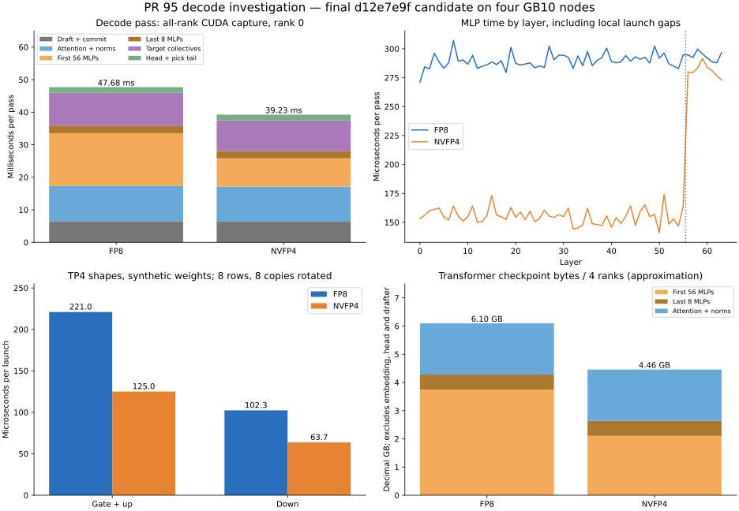
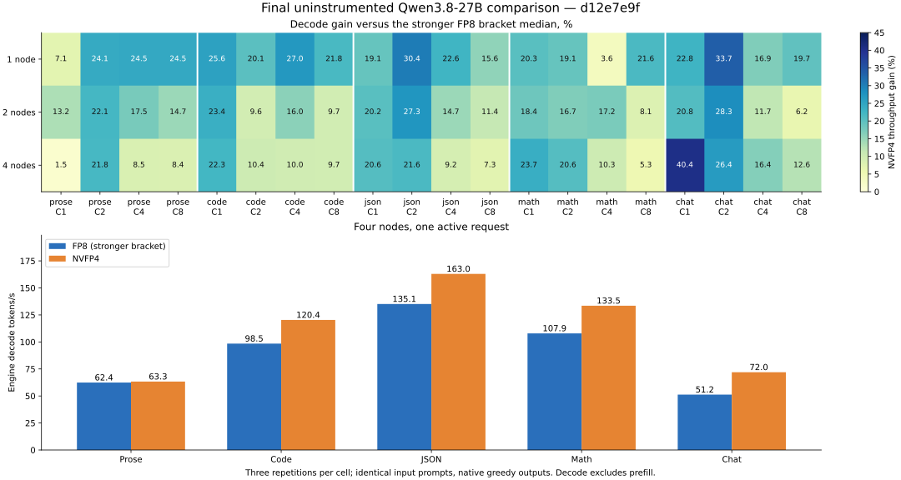

# PR 95: independent review, profiling and optimization

This review tests `unsloth/Qwen3.8-27B-NVFP4` against the existing dense
Qwen3.8-27B FP8 deployment on one, two and four GB10 nodes. The original
contribution is `46715829a5de6ffa9934f17b585c0aaf9dbed010`. The full decode and
profiling campaign uses `d12e7e9fcb8197ad9d91a897a167f5b0df1b6f54`, Release SHA-256
`981d9dd764c4612c3c74f5903d7c42b47e1121733d69b1ad7a45ab345d13ac8f`.
See the [build manifest](decode-release-build-manifest.json) and
[decode source audit](decode-release-source-audit.json).
The final all-world prefill and decode-confirmation follow-up uses
`510542a4e19d4753cebb0ec024f772bca8059e83`, Release SHA-256
`eb103e496fe5ae9fae1620fc21558d5e07ccc98fd40ba85e18de397944a8e5b7`;
see its [build manifest](prefill-pair-build-manifest.json).
Each FP8 / NVFP4 / FP8 bracket uses the same executable for both formats.

The decode campaign and all-world prefill follow-up pass the measured
performance gate: NVFP4 wins
all **60/60 decode cells**, **12/12 cold-prefill buckets**, and **3/3 four-node
longer-context decode buckets**, against the stronger FP8 bracket in each cell.
The exact original production service has been restored on all four nodes.

## What the follow-ups change

- **Exact FP4 prefill:** 256×128×64 physical tiles, with sixteen warps for
  combined gate/up/SwiGLU. Down uses eight warps, or sixteen on long TP2
  products. Paired BF16 stores and measured cache groups preserve dot order
  and scale division. The earlier wider-tile change reduced aggregate FP4
  GEMM time by 31.06% in an 8,353-token profile; uninstrumented serving
  results determine acceptance.
- **Exact small-row FP4 decode:** 16×128×128 tiles with three staging slots,
  one gate/up grid and bounded gate prefetch during the attention fold.
  Dispatch covers the actual TP1/2/4 shapes at 1–16 rows. Other shapes
  retain the original path. The four-node NVFP4 verification cost model
  uses 4 ms per additional row after serving sweeps; FP8 retains 2 ms.
- **Collective hashing:** calculate the existing placement hash while the
  GPU snapshots the activation row. CPU posting reuses it after acquiring
  ready, removing a scan of pinned memory. Control-cell size, wire hash,
  receiver placement checks, canonical rank-order arithmetic and ring
  ownership are preserved; the eager host path is unchanged.
- **Review fixes:** sampled requests no longer use context-lookup proposal
  replacement; disabled MTP layers remain unmaterialized (710 MiB saved
  at TP1 with DFlash2); the FP8 head memory plan counts its local vocabulary
  shard. Tests also follow the current HTTP bind default and its override.

The decode and hashing work is in `16c5a52f` and `d12e7e9f`; the final TP2
prefill scheduling change is `f5a517c1`, followed by gate/up fusion in
`510542a4`. Earlier follow-up
commits contain the prefill and correctness fixes. The
[historical review](prefill-review-history.md) preserves the initial failed
serving cell and rejected numerical/performance alternatives.

The repeated full matrix exposed another narrow exception: two-node 32K
prefill was 0.49% slower than the stronger FP8 bracket. That
[failed matrix](decode-wide-final-matched-audit.json) remains intact.
The sixteen-warp follow-up improved 8K/32K latency by 0.77%/0.82% in an
independent same-format baseline/candidate/baseline trial; see the
[trial audit](prefill16-trial-audit.json). That f5 follow-up retains
[identical eight-warp machine instructions](prefill16-retained-kernel-audit.json).
The first final retest still missed TP2 8K/32K by 0.20%/0.25%; that
[failed retest](prefill16-final-audit.json) is also retained. Combined
same-warp gate/up/SwiGLU then improved same-format 8K/32K by 0.95%/0.66%
against the faster baseline bracket. See the [fusion trial](prefill-pair-warp-trial-audit.json)
and [prefill investigation](prefill-investigation.md).

The [combined audit](release-combined-audit.json) uses fresh final-build
measurements for all twelve prefill buckets, three prose-decode confirmations,
and four-node longer-context decode. It preserves the full earlier 60-cell
decode campaign. All non-prefill CUDA machine instructions are
[unchanged](prefill-pair-retained-kernel-audit.json); the host source diff
restricts the new dispatch to FP4 prefill of at least 1024 rows. Both build
identities and all earlier failed cells are explicit.

## What profiling established

Matched capture was useful, but its overhead was not a uniform scale factor.
All-rank CUDA graph-node traces were substantially less intrusive than
CPU/OS-runtime/GPU-counter sampling. An uninstrumented before/during/after
control showed that counter sampling alone slowed serving materially.
Final performance numbers therefore come from runs without a profiler.

The checkpoint is hybrid: only the first 56 MLPs are FP4. Attention and the
last eight MLPs are FP8, and the head and drafter also remain common costs.
Nominal transformer checkpoint bytes per rank fall from 6.096 to 4.458 GB,
about 26.87%, including scales. This is checkpoint byte accounting, not a
hardware DRAM traffic measurement. The earlier exact decode candidate
measured 28.583 versus 35.087 token/s with drafting disabled (+22.75%).

Final CUDA-only profiles measured the first 56 MLPs at 16.218 ms per FP8 pass
versus 8.695 ms for NVFP4. Attention/norms took 10.83/10.70 ms;
NVFP4 target collectives took 9.47 ms and drafting/commit about 6.40 ms.
The native texts required 88 FP8 versus 105 NVFP4 verification passes for
255 timed tokens. The report separates faster passes from committed-token
throughput instead of inferring one from the other.

See the [detailed investigation](decode-investigation.md) for all-rank
phase/layer/kernel distributions, idle gaps, collective handshake/skew/fold
timing, controlled profiler overhead, weight accounting, rotating matrix
microbenchmarks, Nsight Compute counters, experiments and their limits.
The [raw-profile manifest](decode-raw-profile-manifest.json) identifies the
retained trace files and profiler versions.



## Validation

The full serial 241-entry CTest run finished with **235 passes, six skips
for absent checkpoints, and no failures**. A host-only launcher initialization
fix then replaced an unsynchronized static flag with thread-safe C++ static
initialization. The committed decode/collective rebuild passed all **32 relevant
model, kernel and fabric entries** again. FP4 and hash-oracle CUDA memcheck
reported zero errors; racecheck reported zero hazards.
After the TP2 scheduling change, all **25 affected tests** passed again.
Its memory/race checks instrumented nine launches covering sparse ragged/full
tiles and all output stride/alignment layouts, with zero errors or hazards.
The actual two-node gate/up and down shapes preserve every output bit across
the 3071-/3073-row warp-dispatch boundary. See
[targeted tests](prefill16-tests.log), [memcheck](prefill16-memcheck.log),
and [racecheck](prefill16-racecheck.log).
The final gate/up fusion passed **28 affected tests**, including a direct
bitwise comparison against the existing two GEMMs and actual Qwen SwiGLU.
It covers all BF16 input patterns, independent gate/up payloads/scales/globals,
partial tiles, output guards and actual TP1/2/4 shapes. Memory/race checks
instrument seven paired launches covering layouts and odd pipeline length,
with zero findings. The complete test executable also finishes.
Real-checkpoint full-vocabulary rows match exactly at all 19,456 positions,
plus a fresh-process 4,096-position repeat; see the
[numerical audit](numerical-prefill-pair-comparison.json),
[tests](prefill-pair-tests.log), [memcheck](prefill-pair-memcheck.log),
and [racecheck](prefill-pair-racecheck.log).

See the [validation record](decode-validation.json),
[full suite](decode-wide-full-suite.log), and [final retest](decode-release-tests.log).
Serving performance measurements cover the dense Qwen 27B pair. The shared
collective change also passed the full fabric/model test suite; other model
families' complete serving-performance matrices were not repeated here.

The small-row kernel is bitwise against the independent production reference
across actual TP shapes, ragged columns, row-count boundaries and unaligned
activation/output layouts. The independent collective oracle covers tails,
alignment, changing contents, staging-ring wrap and in-place destinations.
The decode campaign preserved 36 same-format transcript cases against the earlier
audited build. The final prefill build preserved another 36 short transcripts,
108 cold one-token outputs and 27 longer-context responses against that campaign.
Text, token counts and finish reasons match; see the [final audit](prefill-pair-final-audit.json).
Every serving world preserves identical rank operation streams.

A prior 100-case GSM8K sample scored FP8 96/100 and NVFP4 95/100; both scored
100/100 on extraction. These are small quality samples, not evidence of
broad equivalence. The [historical record](prefill-review-history.md) links
full numerical and quality evidence and the rejected lossy alternatives.

## Matched serving results

| Nodes | 512-token prefill reduction | 2K | 8K | 32K | Decode throughput gain across 20 cells |
| --- | ---: | ---: | ---: | ---: | ---: |
| 1 | 14.02% | 4.87% | 1.70% | 1.43% | +3.61% to +33.65% |
| 2 | 12.79% | 6.26% | 1.70% | 1.69% | +6.17% to +28.31% |
| 4 | 9.71% | 3.07% | 1.49% | 1.31% | +1.49% to +40.44% |

| Four-node prompt length | FP8 engine token/s (stronger bracket) | NVFP4 | Gain |
| --- | ---: | ---: | ---: |
| ~1024 | 68.70 | 85.87 | +24.99% |
| ~8192 | 63.88 | 80.04 | +25.29% |
| ~32768 | 61.95 | 75.76 | +22.29% |

On the d12e7e9f decode-campaign executable with drafting disabled, FP8 measured 28.654
versus NVFP4 34.952 token/s (**+21.98%**), using the stronger FP8 bracket.
All three legs used 255 timed decode steps per request. See the [plain-decode audit](decode-release-plain-audit.json).

The [combined audit](release-combined-audit.json) and [context audit](prefill-pair-context-audit.json)
retain every cell, baseline drift and prompt/token matching. These are measured median gains;
small margins and individual repetitions should not be interpreted as a guarantee for every input.
The context buckets use three matched prompts per length, rather than repeating one corpus slice.



The matrix covers five prompt classes, C1/C2/C4/C8,
three repetitions, up to 256 output tokens, and cold 512/2K/8K/32K prefill probes.
Each world runs FP8 / NVFP4 / FP8 with one world active at a time. The
decode gate uses engine token/s at all concurrency levels. Client wall
throughput, including prefill and HTTP time, also wins all 60 corresponding
cells; see the [wall-throughput audit](decode-wall-audit.json). Comparisons
use the stronger FP8 bracket median in every cell. Four-node longer-context
decode additionally covers approximately 1K/8K/32K prompts and up to 512
output tokens, three repetitions each, with cold-prefill counters checked.

Prompt hashes, actual token counts, zero cached prefill, HTTP outcomes,
completion counts, deployed hashes, swap state and rank operation streams
are audited. Raw response text and per-token client timing arrays stay in
the local artifacts; compact records retain their hashes and aggregate data.

## Cluster preparation

Every node has NVFP4 revision `f0b7c9e722f5565102fff8481c99e4d86ae099c7`
and DFlash2 revision `50307d4c4cde6860d4eee73e2547cd786fe8e8a4` in its
Hugging Face cache. Indexed shard maps, tensor headers, lengths and transfer
checksums were verified. NVFP4 files total 23,417,592,488 bytes; their tensor
payload is 23,417,339,744 bytes. See the [cache audit](final-cache-verification.json).

Cleanup removed only resident images belonging to absent checkpoints or
superseded formats after provenance, identity and open-file checks:
303.89 GiB on each of the first two nodes, 539.95 GiB on each of the other
two, **1.65 TiB total**. No model checkpoints were deleted; retained files
were checked. See the [per-node audit](cleanup-audit.json).

At 2026-10-11T11:56:47.483548+00:00, the original `Qwen/Qwen3.8-Flash-Next-FP8` service
was restored on port 18080. Its resolved configuration matches the saved original
exactly; all four live binaries have SHA-256
`5b457ffed0f6290344c68609370e4b58ae893f52b4713ae39362babefea15542`.
Process/cgroup swap is zero and the HTTP smoke check returned the expected answer.
See the [restoration audit](final-restoration-audit.json).

Raw logs, traces, binaries, full responses and exploratory variants remain
in `/home/stephen/dgpp/pr95-followups-20261011/`; the initial review/cache
receipts are in `/home/stephen/dgpp/pr95-review-20261010/`.


## Reproduce

Use reserved, idle hardware, the repository's site configuration, and a new
output directory. This launches the same nine serving legs and audits both
the main matrix and four-node context probes:

```bash
PR95_OUT=/path/to/empty/results PR95_BIN=/path/to/dgpp-serve \
  python3 benchmarks/results/2026-10-11-pr95-followups/run_decode_matrix.py
```

The controller exits unsuccessfully if a performance cell fails. Command
receipts and the [raw-source manifest](decode-raw-manifest.json) accompany
the compact records. Profiling helpers are retained as documentary source;
their local paths identify the original campaign environment.
